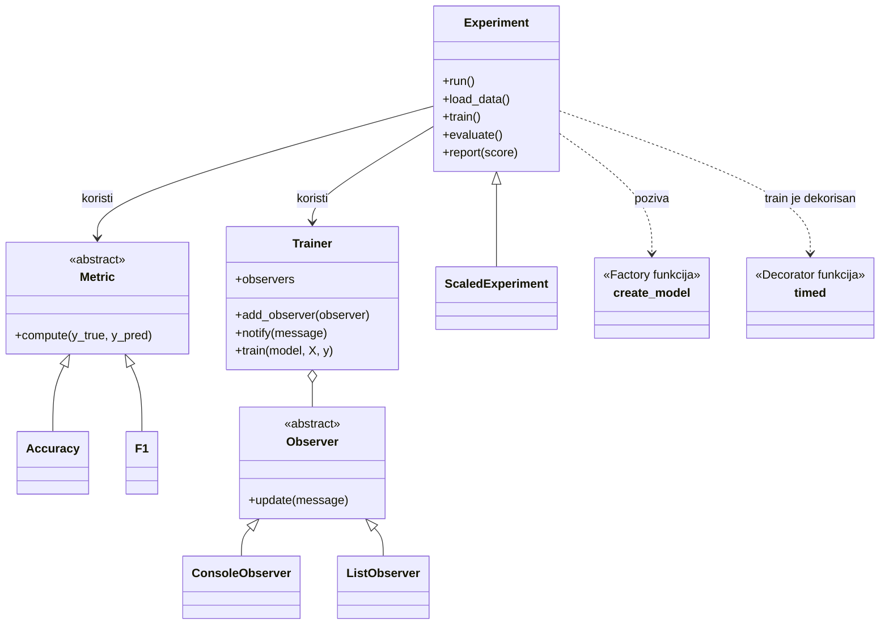
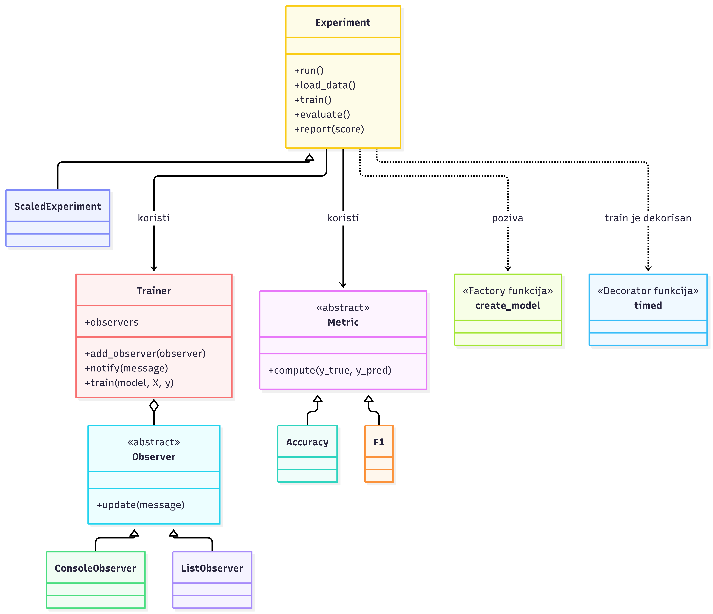

# Softverski šabloni u ML eksperimentima (iris)

Mali školski projekat u Pythonu koji pokazuje pet šablona (Factory, Strategy, Observer, Template Method, Decorator) na skupu iris iz scikit-learn-a.

## Struktura

| Fajl | Šablon | Šta radi |
|---|---|---|
| `factory.py` | Factory | `create_model("linear" / "tree" / "knn")` vraća model |
| `strategy.py` | Strategy | `Accuracy` i `F1` imaju isti interfejs `compute()` |
| `observer.py` | Observer | `Trainer` obavještava `ConsoleObserver` i `ListObserver` |
| `decorator_timing.py` | Decorator | `@timed` mjeri trajanje funkcije |
| `template.py` | Template Method | `Experiment.run()` fiksira korake, `ScaledExperiment` mijenja jedan |
| `demo.py` | | sve zajedno na irisu |
| `test_patterns.py` | | pytest testovi |

## Kako pokrenuti

Potrebni su Python, scikit-learn i pytest.

```
pip install scikit-learn pytest
python demo.py
python -m pytest -q
```

## Primjer upotrebe

```python
from observer import ConsoleObserver
from strategy import F1
from template import Experiment

Experiment("knn", F1(), observers=[ConsoleObserver()]).run()
```

Ime modela se bira stringom (Factory), metrika objektom (Strategy), a posmatrači se prosljeđuju listom (Observer).

## Dijagram klasa



Ako se dijagram ne prikaže u VS Code pregledu, instaliraj ekstenziju "Markdown Preview Mermaid Support". GitHub ga prikazuje sam.



`create_model` (Factory) i `timed` (Decorator) su funkcije, a ne klase, ali su u dijagramu radi preglednosti.

## Šabloni ukratko

- **Factory:** jedna funkcija pravi model na osnovu imena, pa pozivalac ne zna konkretne klase.
- **Strategy:** metrike su zamjenjive klase sa istom metodom `compute`, a bira se pri pozivu.
- **Observer:** `Trainer` javlja početak i kraj treninga, a posmatrači sami odlučuju šta će s porukom.
- **Template Method:** `run()` ima fiksan redoslijed (učitaj, treniraj, evaluiraj, ispiši), a podklasa mijenja samo `load_data`.
- **Decorator:** `@timed` obavija `train()` i ispisuje trajanje bez mijenjanja njenog koda.

## Korišćenje AI alata

Za izradu sam koristio Claude Code (AI asistent u VS Code-u). Radio sam korak po korak: AI je prvo predložio plan, a ja sam ga potvrdio. Zatim smo radili jedan šablon po jedan, uz kratko objašnjenje i pokretanje pytest-a poslije svakog koraka.

Šta je AI radio: predložio strukturu fajlova, napisao kod i testove i objasnio svaki šablon.

Šta sam ja radio: postavljao pitanja kad nešto nisam razumio (npr. razlika između Factory-ja i apstraktne metode, šta radi `evaluate`), tražio izmjene (preimenovanje fajla u `decorator_timing.py`, jasniji ispis u konzoli) i provjeravao rezultate pokretanjem koda.

Svi moji promptovi i šta je AI predložio zapisani su u [AI_LOG.md](AI_LOG.md).
